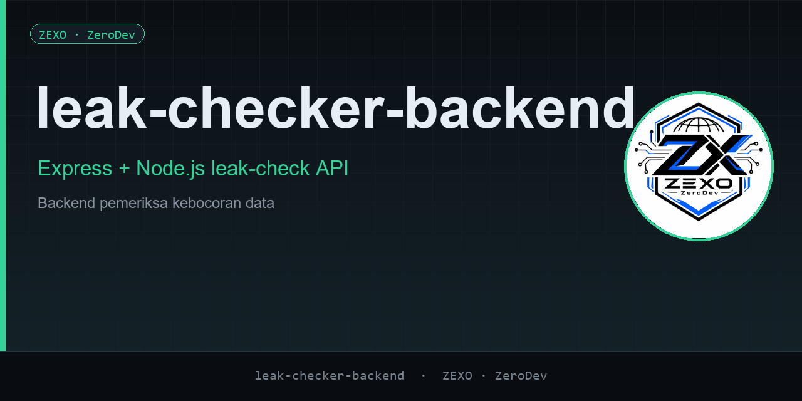

<p align="center">
  
</p>

<p align="center">
  
</p>

<h1 align="center">leak-checker-backend</h1>

<p align="center">Backend pemeriksa kebocoran data</p>

<p align="center">
  
  
  
  
</p>

---

## Tentang

Backend API sederhana untuk pemeriksaan kebocoran data, memakai Express 5 dan `node-fetch`.

## Memulai

```bash
npm install
cp .env.example .env   # sesuaikan
npm start
```

## Endpoint

Lihat `api/check-leak.js` untuk rute yang tersedia.

## Lisensi

ISC — lihat `LICENSE`.
